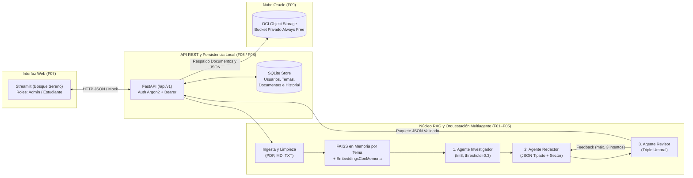

<picture>
  <source media="(prefers-color-scheme: dark)" srcset="assets/logo_nuevamente_menu.svg">
  
</picture>

# Plataforma Multiagente de Capacitación Corporativa con RAG y OCI

**Hackathon ONE G10 (Alura Latam & No Country) — Equipo 30**

🌐 **Demo en línea:** [**https://nuevamente-ia.streamlit.app/**](https://nuevamente-ia.streamlit.app/)
 
*(la API corre integrada en el mismo proceso y carga automáticamente las cuentas y los 4 temas por sector al iniciar).*

**NuevaMente** es una plataforma inteligente de aprendizaje institucional que transforma manuales internos, protocolos técnicos y normativas corporativas (`.pdf`, `.md`, `.txt`) en **experiencias educativas interactivas, personalizadas y verificadas contra alucinaciones** en cuestión de segundos.

---

## 🎯 El Problema a Resolver y Nuestra Solución

### El Problema
Las organizaciones invierten miles de horas redactando protocolos clínicos, manuales de prevención de fraude, políticas operativas y guías de arquitectura técnica. Sin embargo, al momento de capacitar al personal:
1. **Los documentos estáticos no enseñan:** Entregar un PDF extenso produce baja retención y lectura pasiva.
2. **El diseño instruccional manual es lento y costoso:** Transformar un manual en cursos adaptados por nivel toma semanas de trabajo especializado.
3. **Los chats de IA genéricos son riesgosos:** En sectores regulados como **Salud** o **Fintech**, una alucinación o cifra inventada por un LLM sin control puede inducir a errores operativos graves.

### La Solución: NuevaMente
NuevaMente combina **Recuperación Aumentada por Generación (RAG)** aislada por tema, una **arquitectura multiagente con revisión pedagógica por pares (LangGraph + Google Gemini)**, una **interfaz interactiva por roles (Streamlit + FastAPI)** y **persistencia en la nube (Oracle Cloud Infrastructure Object Storage)**:

- **Anclaje estricto a las fuentes:** El **Agente Investigador** recupera los fragmentos relevantes (`k=8`, `score_threshold=0.3`) exclusivamente de los documentos asociados al tema.
- **Adaptación por perfil y sector:** El **Agente Redactor** estructura el material en **5 formatos interactivos** (*Flashcards, Quiz, Tutorial, Resumen y Guion*), adaptando el vocabulario a **3 perfiles** (*Principiante, Intermedio y Avanzado*) y contextualizando ejemplos hipotéticos en **4 sectores** (*Salud, Fintech, E-commerce y General*).
- **Auditoría autónoma anti-alucinación:** El **Agente Revisor** evalúa cada borrador en tres dimensiones (*Fidelidad a la fuente $\ge 0.80$*, *Calidad pedagógica $\ge 0.75$* y *Cumplimiento de formato $\ge 0.75$*). Si un borrador falla, exige su reescritura (hasta 3 intentos) o lo deriva a revisión humana del administrador (`status = "requiere_revision"`), impidiendo que llegue material no verificado al estudiante.

---

## 🏗️ Arquitectura General del Sistema



Cada generación en la API construye un índice FAISS independiente en memoria únicamente con los documentos asociados al tema solicitado, apoyándose en una caché de vectores (`EmbeddingsConMemoria`) que reutiliza los fragmentos ya calculados sin volver a solicitarlos a Gemini, cuidando así el límite de solicitudes por minuto.

---

## 🗺️ Estructura del Proyecto por Épicas y Features (Kanban)

El desarrollo se organizó siguiendo el tablero Kanban del **Equipo 30**:

| Épica | Feature / PBI | Descripción y Alcance Técnico | Módulos Principales | Documentación |
|---|---|---|---|---|
| **E01**<br/>Pipeline de Ingesta (`#2`) | **F01** (`#9`): Ingesta y Limpieza de Documentos | Extracción multiformato (`.pdf`, `.md`, `.txt`), normalización de texto (`clean_and_normalize_text`), filtrado de páginas vacías y validaciones de formato y tamaño. | [`src/ingestion.py`](src/ingestion.py)<br/>[`api/documents.py`](api/documents.py) | — |
| **E02**<br/>Núcleo del RAG y Vector Store (`#3`) | **F02** (`#11`): RAG: Chunking, Embeddings y Vector Store | Segmentación con `RecursiveCharacterTextSplitter` (`1000` caracteres, solapamiento `100`), embeddings con `models/gemini-embedding-001`, memoria de vectores (`EmbeddingsConMemoria`) e índice vectorial **FAISS** por tema. | [`src/chunk_embeddings.py`](src/chunk_embeddings.py)<br/>[`src/the_models.py`](src/the_models.py) | — |
| **E03**<br/>Orquestación Multi-Agente (`#4`) | **F03** (`#12` / PBI `#15`): Agente Investigador RAG<br/>**F04** (`#13` / PBI `#16`): Agente Redactor Pedagógico<br/>**F05** (`#14` / PBI `#17`): Agente Revisor | Grafo **LangGraph** (`Researcher -> Writer -> Reviewer`). Recuperación `k=8`, cantidades recomendadas por formato, adaptación por sector (`Salud`, `Fintech`, `E-commerce`, `General`) y bucle de autocorrección con 3 métricas. | [`src/graph.py`](src/graph.py)<br/>[`src/agents/researcher.py`](src/agents/researcher.py)<br/>[`src/agents/writer.py`](src/agents/writer.py)<br/>[`src/agents/reviewer.py`](src/agents/reviewer.py) | [📄 F03–F05: Orquestación Multiagente](docs/hito_3_multiagente.md) |
| **E04**<br/>Estructuración de Salida y Metadatos (`#5`) | **F06** (`#18`): Output Estructurado | Esquemas estrictos en **Pydantic v2** (`EducationalResponse`), validación por formato (`Quiz`, `Flashcards`, `Tutorial`, `Resumen`, `Guion`), metadatos de estudio, citas de fuentes y persistencia en SQLite. | [`src/schemas.py`](src/schemas.py)<br/>[`src/generation.py`](src/generation.py)<br/>[`api/contracts.py`](api/contracts.py)<br/>[`api/database.py`](api/database.py) | [📄 F06: Salida Estructurada y SQLite](docs/backend_fastapi_sqlite.md) |
| **E05**<br/>Interfaz y Pruebas (`#6`) | **F07** (`#19`): Base de Interfaz<br/>• PBI01-F07 (`#20`): Maquetado Streamlit<br/>• PBI02-F07 (`#40`): Vistas interactivas<br/>• PBI03-F07 (`#45`): Flujo por roles | Interfaz en **Streamlit** con identidad visual *"Bosque sereno"*, landing interactiva, acceso en tarjeta flotante, volteo de flashcards, quiz con justificaciones, tutorial paso a paso y paneles por rol (`admin` y `estudiante`). | `app/inicio.py`<br/>`app/cliente_api.py`<br/>`app/vistas/`<br/>`app/paginas/` | [📄 F07: Guía de la Interfaz](app/README.md)<br/>[📄 F07: Diseño de Interfaz](docs/F07-diseno-interfaz.md) |
| **E05**<br/>Interfaz y Pruebas (`#6`) | **F08** (`#21`): Integración y Pruebas E2E<br/>• PBI01-F08 (`#22`): Conexión backend-frontend<br/>• PBI02-F08 (`#23`): Escenarios múltiples | Sesiones Bearer, hash Argon2 (`pwdlib`), cambio obligatorio de clave temporal, límite de intentos de login, gestión de temas por sector, aprobación/rechazo de material pendiente y suite de pruebas E2E. | [`api/main.py`](api/main.py)<br/>[`api/auth.py`](api/auth.py)<br/>[`api/routes/`](api/routes/)<br/>[`tests/test_api_integracion.py`](tests/test_api_integracion.py) | [📄 F08: Uso de la API HTTP](docs/uso_api.md) |
| **E06**<br/>Integración con OCI (`#7`) | **F09** (`#24`): Object Storage | Respaldo automático en **OCI Object Storage** (bucket privado en la capa Always Free) de documentos originales y paquetes educativos JSON aprobados, con degradación limpia cuando no hay credenciales locales. | [`src/oci_storage.py`](src/oci_storage.py)<br/>[`tests/test_oci_storage.py`](tests/test_oci_storage.py)<br/>[`tests/validate_live_oci.py`](tests/validate_live_oci.py) | [📄 F09: Integración con OCI](docs/hito_9_integracion_oci.md) |
| **E07**<br/>Documentación (`#8`) | **F10** (`#25` / PBI `#26`): Documentación y Demo | Documentación general del proyecto, script idempotente de cuentas demo (`admin_demo`, `estudiante_demo`, `temporal_demo`) y carga de los 4 temas de demostración por sector desde `data/`. | [`scripts/crear_cuentas_demo.py`](scripts/crear_cuentas_demo.py)<br/>[`tests/test_cuentas_demo.py`](tests/test_cuentas_demo.py) | [📄 F10: Cuentas y Temas Demo](docs/cuentas_demo.md) |

---

## 📦 Contrato Educativo y Formatos de Salida

Cada generación devuelve un objeto JSON validado por Pydantic con `status` (`exito` o `requiere_revision`), `metadatos`, `contenido_adaptado`, `evaluacion_calidad` y `fuentes` (documento, fragmento, página y extracto). Ejemplo completo en [`examples/respuesta_flashcards.json`](examples/respuesta_flashcards.json).

| Formato | Volumen Recomendado | Estructura de cada ítem (`contenido_adaptado.items`) |
|---|---|---|
| **Flashcards** | 8 a 12 tarjetas | `frente`, `dorso`, `pista_didactica` |
| **Quiz** | 5 a 8 preguntas | `pregunta`, `opciones` (mín. 2), `respuesta_correcta`, `justificacion` |
| **Tutorial** | 5 a 8 pasos | `titulo`, `instrucciones` |
| **Resumen** | 4 a 6 secciones | `subtitulo`, `texto` |
| **Guion** | 4 a 6 bloques | `titulo`, `narracion` |

---

## ⚙️ Instalación y Configuración

Desde la raíz del repositorio, con **Python 3.11 o superior**:

```powershell
python -m venv .venv
.\.venv\Scripts\python.exe -m pip install -r requirements.txt
if (-not (Test-Path .env)) { Copy-Item .env.example .env }
```

Edita `.env` y configura tu clave `GEMINI_API_KEY` (obtenible gratis en [Google AI Studio](https://aistudio.google.com)).
- La base de datos SQLite se crea automáticamente al iniciar en `storage/nuevamente.sqlite3`.
- Las credenciales de **OCI Object Storage** son opcionales en desarrollo local: si no están configuradas, el backend opera con degradación limpia (`status_upload="omitido"`) sin interrumpir ningún flujo.

---

## 🚀 Puesta en Marcha Rápida (Backend + Cuentas Demo + Frontend)

### 1. Sembrar Cuentas Demo y los 4 Temas por Sector en SQLite

El script [`scripts/crear_cuentas_demo.py`](scripts/crear_cuentas_demo.py) crea las tres cuentas reales de prueba (`admin_demo`, `estudiante_demo` y `temporal_demo`). Con `--con-tema-demo` carga los **4 temas de demostración, uno por sector** (*Fintech, Salud, E-commerce y General*), con sus documentos en `data/`, y los asigna a ambos estudiantes:

```powershell
.\.venv\Scripts\python.exe -m scripts.crear_cuentas_demo --con-tema-demo
```

- Con `--claves-fijas` toma las contraseñas de `DEMO_ADMIN_PASSWORD`, `DEMO_ESTUDIANTE_PASSWORD` y `DEMO_TEMPORAL_PASSWORD` definidas en `.env` sin mostrarlas por consola.
- También puedes crear un administrador manual con `.\.venv\Scripts\python.exe -m api.crear_admin`.
- Guía detallada en [`docs/cuentas_demo.md`](docs/cuentas_demo.md).

### 2. Iniciar el Servidor Backend (FastAPI)

```powershell
.\.venv\Scripts\python.exe -m uvicorn api.main:app --reload --host 127.0.0.1 --port 8000
```

- **Swagger UI interactivo:** http://127.0.0.1:8000/docs
- **Esquema OpenAPI:** http://127.0.0.1:8000/openapi.json
- **Healthcheck (API + SQLite):** http://127.0.0.1:8000/health

### 3. Iniciar la Interfaz Web (Streamlit)

- **Modo conectado al Backend Real (`MODO_API=http`):**
  ```powershell
  $env:MODO_API="http"
  $env:URL_API="http://127.0.0.1:8000"
  $env:TIEMPO_MAXIMO_SEGUNDOS="300"
  .\.venv\Scripts\python.exe -m streamlit run app/inicio.py
  ```
- **Modo Demostración Instantánea sin Backend (`MODO_API=mock`, por defecto):**
  ```powershell
  .\.venv\Scripts\python.exe -m streamlit run app/inicio.py
  ```
  *(Las cuentas de demostración se muestran directamente en la pantalla de acceso de la aplicación. Más detalles sobre roles, modos y despliegue en [`app/README.md`](app/README.md)).*

---

## 🔌 Resumen de Endpoints de la API (`/api/v1`)

Todas las rutas, salvo `/health` y `POST /api/v1/sesion`, requieren `Authorization: Bearer <token>`. Consulta los ejemplos detallados en [`docs/uso_api.md`](docs/uso_api.md).

| Método | Ruta | Rol | Resultado |
|---|---|---|---|
| `GET` | `/health` | Público | Salud de API y SQLite. |
| `POST / GET / DELETE` | `/api/v1/sesion` | Público / Autenticado | Iniciar sesión, ver quién soy (usuario, rol y temas) o cerrar sesión. |
| `PUT` | `/api/v1/sesion/contrasena` | Autenticado | Cambiar contraseña (obligatorio en cuentas con clave temporal). |
| `GET / POST` | `/api/v1/usuarios` | Admin | Listar usuarios con sus temas o crear un estudiante con temas. |
| `PUT` | `/api/v1/usuarios/{id_usuario}` | Admin | Modificar a un estudiante: nombre, `activo` o contraseña temporal. |
| `POST` | `/api/v1/usuarios/{id_usuario}/desbloqueo` | Admin | Quita el bloqueo por intentos fallidos de login (`204`). |
| `GET / POST` | `/api/v1/temas` | Autenticado / Admin | Listar (estudiante: solo asignados) o crear temas con nicho, nivel de detalle y documentos. |
| `GET / PATCH / DELETE` | `/api/v1/temas/{id_tema}` | Asignado / Admin | Ver, configurar o borrar un tema (el historial se conserva). |
| `GET, PUT, DELETE` | `/api/v1/temas/{id_tema}/documentos[/{documento_id}]` | Asignado / Admin | Consultar, asociar (`PUT`) o desasociar (`DELETE`) documentos del tema. |
| `GET, PUT, DELETE` | `/api/v1/temas/{id_tema}/estudiantes[/{id_usuario}]` | Admin | Consultar, asignar (`PUT`) o desasignar (`DELETE`) estudiantes del tema. |
| `GET` | `/api/v1/catalogos` | Autenticado | Perfiles, formatos, sectores y límites de documentos. |
| `POST` | `/api/v1/documentos[/texto]` | Admin | Subir archivo (`archivo`) o texto y respaldarlo en OCI. |
| `GET` | `/api/v1/documentos[/{id}[/original]]` | Admin | Lista de documentos, texto extraído y descarga del archivo original. |
| `POST` | `/api/v1/contenidos` | Autenticado | Generar por `id_tema`, validar y guardar (`201` si aprueba; `202` si queda en revisión). |
| `GET` | `/api/v1/contenidos` | Autenticado | Historial propio (admin: todo); filtros `id_tema`, `documento_id`, `perfil`, `status` y (admin) `pendiente`. |
| `GET` | `/api/v1/contenidos/{id}[/descarga]` | Dueño / Admin | JSON educativo completo con fuentes citadas o descarga. |
| `POST` | `/api/v1/contenidos/{id}/aprobar` \| `/rechazar` | Admin | Revisión manual del material `requiere_revision` (al aprobar se respalda en OCI). |

---

## 🧪 Ejecución de Pruebas Automatizadas

La suite de pruebas automatizadas valida el grafo multiagente, los esquemas Pydantic, las rutas HTTP, los roles, el sembrado de cuentas, el cliente OCI y la interfaz de usuario sin requerir conexión a internet ni credenciales externas:

```powershell
# Ejecutar toda la suite de pruebas con pytest
.\.venv\Scripts\python.exe -m pytest -v

# Pruebas de la interfaz (F07)
.\.venv\Scripts\python.exe -m unittest discover -s tests -p "test_interfaz*.py"
```

---

## 📚 Documentación Técnica por Módulo

- [**F03–F05:** Orquestación multiagente y adaptación por sector](docs/hito_3_multiagente.md)
- [**F06:** Salida estructurada, contrato educativo y persistencia SQLite](docs/backend_fastapi_sqlite.md)
- [**F07:** Guía de la interfaz, roles, modos y despliegue](app/README.md)
- [**F07:** Diseño e identidad visual de la interfaz en Streamlit](docs/F07-diseno-interfaz.md)
- [**F08:** Guía de uso de la API HTTP con ejemplos paso a paso](docs/uso_api.md)
- [**F09:** Integración con OCI Object Storage (Always Free)](docs/hito_9_integracion_oci.md)
- [**F10:** Creación de cuentas demo y carga de temas por sector](docs/cuentas_demo.md)
