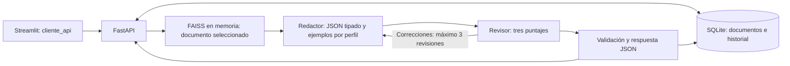

# G-10-Latam-equipo30
Hackathon ONE G10 - LATAM Equipo 30

Backend de NuevaMente: documentos técnicos → RAG → agentes → contenido educativo JSON. La rama `Feature/F06-Output-Estructurado` incorpora **Structured Outputs, FastAPI y SQLite**. El frontend Streamlit se desarrolla por separado y consume HTTP; no necesita importar el grafo.

## Alcance y contrato

- Perfiles permitidos: **Principiante, Intermedio y Avanzado**, con esas mayúsculas.
- Formatos: **Flashcards, Resumen, Quiz, Tutorial y Guion**.
- Carga de PDF, Markdown y TXT; generación por documento; historial persistente y descarga JSON.
- El revisor conserva las tres evaluaciones del equipo: fidelidad >= 0.80, pedagogía >= 0.75 y formato >= 0.75. Deben cumplirse todas para aprobar.
- Tras tres revisiones sin aprobación, el JSON indica `requiere_revision`.
- Se conservan los campos principales del ejemplo del PDF: `status`, `metadatos`, `contenido_adaptado`, `evaluacion_calidad`. La evaluación también expone los dos puntajes de pedagogía y formato existentes en esta rama.
- Esta entrega cubre documentos, generación e historial. Autenticación, usuarios, roles, temas asignados, exámenes, frontend y OCI no se implementan aquí. El historial de este backend local es compartido.

La tabla de responsabilidades recibida menciona `src/contrato.py`, pero ese archivo y `app/cliente_api.py` no están en esta rama. El contrato HTTP de esta entrega está en `api/contracts.py` y OpenAPI. El equipo deberá comparar sus rutas y campos con el contrato compartido antes de integrarlo; no se modificaron archivos del frontend ni sus mocks.

## Arquitectura



SQLite guarda originales, texto extraído, solicitudes y respuestas. FAISS conserva su función de búsqueda semántica: la API crea un índice independiente en memoria por generación, utilizando únicamente el documento seleccionado. No altera el índice global `vectorstore/` del CLI. Los embeddings se recalculan en cada generación de la API.

## Instalación

Desde la raíz de **este repositorio**, con Python 3.11 o superior:

```powershell
python -m venv .venv
.\.venv\Scripts\python.exe -m pip install -r requirements.txt
if (-not (Test-Path .env)) { Copy-Item .env.example .env }
```

Edita `.env` y configura `GEMINI_API_KEY`. Las rutas relativas de `NUEVAMENTE_DB_PATH` se resuelven desde la raíz del proyecto. Los modelos permanecen en `src/the_models.py`; deben estar disponibles para tu cuenta. No publiques tu clave en el frontend.

La API puede iniciarse, recibir documentos y consultar historial sin clave; solo la generación requiere Gemini. SQLite se incluye en Python: no necesitas instalar un servidor de base de datos.

Para la ingesta Markdown del CLI histórico, instala además sus recursos NLTK:

```powershell
.\.venv\Scripts\python.exe -m nltk.downloader -d .venv/nltk_data punkt_tab averaged_perceptron_tagger_eng
```

La carga Markdown de la API conserva el texto UTF-8 y no requiere ese paso. En Linux/macOS usa `.venv/bin/python`.

## Iniciar la API

```powershell
.\.venv\Scripts\python.exe -m uvicorn api.main:app --reload --host 127.0.0.1 --port 8000
```

- Documentación interactiva: http://127.0.0.1:8000/docs
- OpenAPI: http://127.0.0.1:8000/openapi.json
- Salud de API y SQLite: http://127.0.0.1:8000/health

La base se crea al iniciar en `storage/nuevamente.sqlite3`. Originales y generaciones sobreviven al reinicio. Detén el servidor con Ctrl+C. El enlace de salud comprueba SQLite; no comprueba la cuota ni disponibilidad de Gemini.

## Endpoints para el equipo frontend

| Método | Ruta | Resultado |
| --- | --- | --- |
| GET | `/health` | Salud de API y SQLite. |
| GET | `/api/v1/catalogos` | Perfiles, formatos y límites de documentos. |
| POST | `/api/v1/documentos` | Subir archivo multipart en el campo `archivo`; título opcional `documento_titulo`. |
| POST | `/api/v1/documentos/texto` | Crear desde JSON con `documento_titulo` y `documento_contenido`. |
| GET | `/api/v1/documentos` | Lista paginada. |
| GET | `/api/v1/documentos/{id}` | Metadatos y texto extraído. |
| GET | `/api/v1/documentos/{id}/original` | Descargar el original. |
| POST | `/api/v1/contenidos` | Generar, validar y guardar el JSON educativo. |
| GET | `/api/v1/contenidos` | Historial paginado; filtros `documento_id`, `perfil` y `status`. |
| GET | `/api/v1/contenidos/{id}` | Recuperar el JSON educativo completo. |
| GET | `/api/v1/contenidos/{id}/descarga` | Descargar ese JSON. |

Las listas usan `limit` (1–100, por defecto 20) y `offset` (desde 0), y devuelven `items`, `total`, `limit` y `offset`. Los identificadores son cadenas de 32 caracteres hexadecimales generadas por el backend.

Carga un documento en Swagger o con:

```powershell
curl.exe -X POST http://127.0.0.1:8000/api/v1/documentos -F "archivo=@data/arquitectura_redes_vcn_oci.md"
```

Copia su `id` en esta solicitud a `POST /api/v1/contenidos`:

```json
{
  "documento_id": "REEMPLAZAR_CON_EL_ID_RECIBIDO",
  "tema": "¿Qué es una VCN y cuáles son sus componentes?",
  "perfil_destinatario": "Intermedio",
  "formato_salida": "Flashcards",
  "nicho_sector": "General",
  "nivel_detalle": "Didáctico"
}
```

La respuesta de creación usa HTTP **201** y su cuerpo es directamente el objeto educativo, sin envolverlo en otro objeto. Lee el identificador de la cabecera **`X-Contenido-ID`** y la ruta del recurso en **`Location`**. HTTP 201 significa que se creó el registro; revisa también `status`, que puede ser `exito` o `requiere_revision`.

Ejemplo ilustrativo completo: [examples/respuesta_flashcards.json](examples/respuesta_flashcards.json). Los minutos son una estimación de estudio, no el tiempo de ejecución. El score es una evaluación del LLM, no una garantía absoluta de exactitud.

## Formato de los items

Todos los contenidos tienen `titulo`, `introduccion_contextualizada` e `items`.

| Formato | Campos de cada item |
| --- | --- |
| Flashcards | `frente`, `dorso`, `pista_didactica`. |
| Resumen | `subtitulo`, `texto`. |
| Quiz | `pregunta`, `opciones`, `respuesta_correcta`, `justificacion`. |
| Tutorial | `titulo`, `instrucciones`; la lista define el orden. |
| Guion | `titulo`, `narracion`. |

Pydantic rechaza campos extra, tipos incompatibles, textos vacíos, minutos menores que 1 y puntajes no finitos o fuera de 0–1. En quizzes se requieren al menos dos opciones distintas y la respuesta correcta debe coincidir con una opción. Perfil, formato, sector y detalle del resultado deben corresponder a la solicitud.

## Cómo usar la API

Sigue la [guía de uso paso a paso](docs/uso_api.md): incluye Swagger, comandos PowerShell completos, carga de archivos o texto, generación, consulta del historial, descarga y manejo de errores.

El flujo es: cargar documento → copiar su ID → generar → leer `X-Contenido-ID` → consultar o descargar el resultado. En `/docs` puedes completar todo el flujo sin crear un frontend.

Por petición del responsable de esta entrega se retiraron las pruebas nuevas de F06. Se conservan las pruebas del equipo, con los ajustes de compatibilidad necesarios para la salida estructurada. Por petición del responsable se eliminó el workflow hito3-tests.yml: esas pruebas ya no se ejecutan automáticamente mediante ese flujo de GitHub Actions.

## CLI existente

El CLI usa el índice global local, no el historial SQLite de la API:

```powershell
.\.venv\Scripts\python.exe src/main.py
.\.venv\Scripts\python.exe src/generate.py --tema "¿Qué es una VCN?" --perfil Principiante --formato Flashcards --salida output/vcn.json
.\.venv\Scripts\python.exe src/generate.py --schema
```

Indexar vuelve a crear `vectorstore/` con los documentos seleccionados. Para la API no hace falta ejecutar este paso: se sube el documento por HTTP.

## Errores y límites

Los errores HTTP usan el mismo sobre: `{"status":"error","error":{"codigo":"...","mensaje":"..."}}`.

| HTTP | Casos principales |
| --- | --- |
| 404 | Documento o contenido inexistente. |
| 413 | Más de 10 MiB, 100 páginas PDF o 250000 caracteres extraídos. |
| 415 | Extensión no soportada. |
| 422 | Perfil/entrada inválida, PDF inválido/protegido, texto insuficiente o tema sin contexto. |
| 502 | Fallo del proveedor o salida incompatible con el contrato. |
| 503 | Clave sin configurar o persistencia SQLite no disponible. |

PDF escaneado requiere OCR previo; MD/TXT requieren UTF-8. Las respuestas inválidas no se guardan como generaciones. `requiere_revision` sí se conserva y puede filtrarse para revisión posterior. No se mantiene una transacción SQLite abierta mientras responde Gemini.

## Documentación

- [Uso de la API con ejemplos completos](docs/uso_api.md).
- [Guía del backend y decisiones F06](docs/backend_fastapi_sqlite.md).
- [Guía personal de cambios](guiapersonal.md).
- [Hito 3 del equipo](docs/hito_3_multiagente.md).
- [FastAPI: archivos](https://fastapi.tiangolo.com/tutorial/request-files/) y [SQLite de Python](https://docs.python.org/3/library/sqlite3.html).

Los datos locales, `.env`, `.venv/`, `storage/` y `output/` no se versionan.
